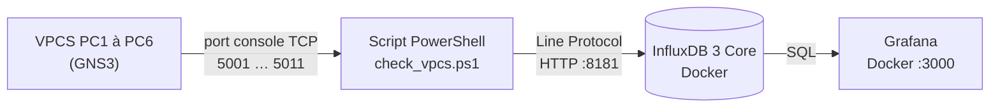

# Tp_QOS_0 – Concepts QoS (Quality of Service)

TP Module 9 – CCNA Enterprise Networking, Security, and Automation
Satom IT & Learning Solutions · Geneva Institute of Technology
Outil : GNS3 avec routeurs Cisco IOS (c7200)

## 1. Contexte

Le siège et la succursale sont reliés par un lien WAN série de 1 Mb/s. Trois types de trafic y circulent : la voix sur IP, les données métier et le trafic best-effort. En heure de pointe, la voix devient hachée. Objectif : mettre en place une politique QoS (marquage + LLQ) qui garantit la voix sans sacrifier les données.

## 2. Topologie


| Équipement | Interface | Adresse | Passerelle |
|---|---|---|---|
| R1 | Gi0/0 | 192.168.1.1/24 | — |
| R1 | **Serial1/3** | 10.1.1.1/30 | — |
| R2 | Gi0/0 | 192.168.2.1/24 | — |
| R2 | **Serial1/3** | 10.1.1.2/30 | — |
| PC-Voix | NIC | 192.168.1.10/24 | 192.168.1.1 |
| PC-Données | NIC | 192.168.1.20/24 | 192.168.1.1 |
| Serveur | NIC | 192.168.2.10/24 | 192.168.2.1 |

> **Adaptation GNS3 :** l'énoncé (Packet Tracer) utilise `Se0/0/0`. Dans ce lab, le lien série est **`Serial1/3`**. Toutes les commandes de l'énoncé ont été adaptées en conséquence.

## 3. Étape 1 – Adressage et routage de base

Configuration : adresses IP, routes statiques (`ip route 192.168.2.0 255.255.255.0 10.1.1.2` sur R1, `ip route 192.168.1.0 255.255.255.0 10.1.1.1` sur R2) et `bandwidth 1000` sur `Serial1/3` des deux routeurs.

<details>
<summary>show running-config de R1 (configuration de base)</summary>

```
R1#show running-config
Building configuration...

Current configuration : 1190 bytes
!
version 15.2
service timestamps debug datetime msec
service timestamps log datetime msec
!
hostname R1
!
boot-start-marker
boot-end-marker
!
!
!
no aaa new-model
no ip icmp rate-limit unreachable
!
!
!
!
!
!
no ip domain lookup
ip cef
no ipv6 cef
!
!
multilink bundle-name authenticated
!
!
!
!
!
!
!
!
!
!
!
!
ip tcp synwait-time 5
!
!
!
!
!
!
!
!
!
interface Ethernet0/0
 no ip address
 shutdown
 duplex auto
!
interface GigabitEthernet0/0
 ip address 192.168.1.1 255.255.255.0
 media-type gbic
 speed 1000
 duplex full
 negotiation auto
!
interface Serial1/0
 no ip address
 shutdown
 serial restart-delay 0
!
interface Serial1/1
 no ip address
 shutdown
 serial restart-delay 0
!
interface Serial1/2
 no ip address
 shutdown
 serial restart-delay 0
!
interface Serial1/3
 bandwidth 1000
 ip address 10.1.1.1 255.255.255.252
 serial restart-delay 0
!
ip forward-protocol nd
!
!
no ip http server
no ip http secure-server
ip route 192.168.2.0 255.255.255.0 10.1.1.2
!
!
!
!
control-plane
!
!
line con 0
 exec-timeout 0 0
 privilege level 15
 logging synchronous
 stopbits 1
line aux 0
 exec-timeout 0 0
 privilege level 15
 logging synchronous
 stopbits 1
line vty 0 4
 login
!
!
end

R1#
```

</details>

<details>
<summary>show running-config de R2 (configuration de base)</summary>

```
R2#show running-config
Building configuration...

Current configuration : 1190 bytes
!
version 15.2
service timestamps debug datetime msec
service timestamps log datetime msec
!
hostname R2
!
boot-start-marker
boot-end-marker
!
!
!
no aaa new-model
no ip icmp rate-limit unreachable
!
!
!
!
!
!
no ip domain lookup
ip cef
no ipv6 cef
!
!
multilink bundle-name authenticated
!
!
!
!
!
!
!
!
!
!
!
!
ip tcp synwait-time 5
!
!
!
!
!
!
!
!
!
interface Ethernet0/0
 no ip address
 shutdown
 duplex auto
!
interface GigabitEthernet0/0
 ip address 192.168.2.1 255.255.255.0
 media-type gbic
 speed 1000
 duplex full
 negotiation auto
!
interface Serial1/0
 no ip address
 shutdown
 serial restart-delay 0
!
interface Serial1/1
 no ip address
 shutdown
 serial restart-delay 0
!
interface Serial1/2
 no ip address
 shutdown
 serial restart-delay 0
!
interface Serial1/3
 bandwidth 1000
 ip address 10.1.1.2 255.255.255.252
 serial restart-delay 0
!
ip forward-protocol nd
!
!
no ip http server
no ip http secure-server
ip route 192.168.1.0 255.255.255.0 10.1.1.1
!
!
!
!
control-plane
!
!
line con 0
 exec-timeout 0 0
 privilege level 15
 logging synchronous
 stopbits 1
line aux 0
 exec-timeout 0 0
 privilege level 15
 logging synchronous
 stopbits 1
line vty 0 4
 login
!
!
end

R2#
```

</details>

**Vérification de la connectivité**

Ping de R1 vers PC-Données :


Ping de R1 vers le serveur à travers le WAN :

```
R1#ping 192.168.2.10
Type escape sequence to abort.
Sending 5, 100-byte ICMP Echos to 192.168.2.10, timeout is 2 seconds:
!!!!!
Success rate is 100 percent (5/5), round-trip min/avg/max = 40/47/56 ms
```

Ping de PC-Données vers le serveur `192.168.2.10` (routage de bout en bout) :


## 4. État initial, avant activation de la QoS

Avant d'appliquer la moindre politique, `show policy-map interface Serial1/3` sur R1 ne renvoie aucune sortie : aucune politique n'est attachée à l'interface.

```
R1#show policy-map interface Serial1/3
R1#
```

## 5. Étape 2 – Classification et marquage (R1)

```
configure terminal
ip access-list extended VOIX-PORT
 permit udp any any range 16384 32767
ip access-list extended DONNEES-ACL
 permit ip host 192.168.1.20 any
exit
class-map match-any VOIX
 match dscp ef
 match access-group name VOIX-PORT
class-map match-any DONNEES
 match access-group name DONNEES-ACL
policy-map MARQUAGE
 class VOIX
  set dscp ef
 class DONNEES
  set dscp af21
interface GigabitEthernet0/0
 service-policy input MARQUAGE
end
```

> **Remarque :** l'énoncé référence l'ACL `DONNEES-ACL` sans jamais la créer. Elle a été ajoutée (`permit ip host 192.168.1.20 any`, soit PC-Données), sinon la classe DONNEES ne match rien.

## 6. Étape 3 – File prioritaire LLQ sur le WAN (R1)

```
configure terminal
policy-map WAN-QOS
 class VOIX
  priority percent 30
 class DONNEES
  bandwidth percent 50
 class class-default
  fair-queue
interface Serial1/3
 service-policy output WAN-QOS
end
```

> **Remarque :** la commande `max-reserved-bandwidth 100` est refusée sur cette image IOS (`% Invalid input detected`). Elle n'est pas nécessaire ici : la politique est acceptée sans elle.

Vérifications :

```
R1#show class-map
 Class Map match-any VOIX (id 1)
   Match   dscp ef (46)
   Match access-group name  VOIX-PORT

 Class Map match-any class-default (id 0)
   Match any

 Class Map match-any DONNEES (id 2)
   Match access-group name  DONNEES-ACL

R1#show policy-map
  Policy Map WAN-QOS
    Class VOIX
      priority 30 (%)
    Class DONNEES
      bandwidth 50 (%)
    Class class-default
      fair-queue

  Policy Map MARQUAGE
    Class VOIX
      set dscp ef
    Class DONNEES
      set dscp af21
```

## 7. Étape 4 – Calcul et vérification

**Calcul :** 4 appels G.711 × 87 kb/s = **348 kb/s**. Avec `priority percent 30`, la voix dispose de 30 % × 1 Mb/s = **300 kb/s**, soit moins que le besoin. En cas de congestion, tout ce qui dépasse 300 kb/s dans la classe VOIX serait jeté (`b/w exceed drops`), donc au-delà de 3 appels la qualité se dégrade.

**Correction :** `priority percent 40` = 400 kb/s, supérieur aux 348 kb/s requis, avec une marge de 52 kb/s.

```
configure terminal
policy-map WAN-QOS
 class VOIX
  priority percent 40
end
```

Après modification, `show policy-map interface Serial1/3` affiche `Priority: 40% (400 kbps), burst bytes 10000`.

### Test de la voix

PC-Données et PC-Voix (VPCS) ne savent générer ni de l'UDP 16384-32767 ni du DSCP EF. La voix est donc simulée depuis R1 par un ping étendu marqué **DSCP EF** (ToS 184 = 46 × 4) :

```
R1#ping 192.168.2.10 source 192.168.1.1 size 1000 repeat 100 tos 184
Type escape sequence to abort.
Sending 100, 1000-byte ICMP Echos to 192.168.2.10, timeout is 2 seconds:
Packet sent with a source address of 192.168.1.1
.!!!!!!!!!!!!!!!!!!!!!!!!!!!!!!!!!!!!!!!!!!!!!!!!!!!!!!!!!!!!!!!!!!!!!
!!!!!!!!!!!!!!!!!!!!!!!!!!!!!!
Success rate is 99 percent (99/100), round-trip min/avg/max = 32/54/1116 ms
```

Le premier paquet perdu et le maximum de 1116 ms correspondent à la mise en route (résolution ARP, premier paquet sur le lien série).

### Compteurs après trafic (rendu « après »)

Classe **VOIX** : 100 paquets / 100 400 octets, tous matchés par `dscp ef`, **0 drop**, et 100 paquets sortis par la file prioritaire :

```
R1#show policy-map interface Serial1/3 output class VOIX
 Serial1/3

  Service-policy output: WAN-QOS

    queue stats for all priority classes:
      Queueing
      queue limit 64 packets
      (queue depth/total drops/no-buffer drops) 0/0/0
      (pkts output/bytes output) 100/100400

    Class-map: VOIX (match-any)
      100 packets, 100400 bytes
      5 minute offered rate 2000 bps, drop rate 0000 bps
      Match:  dscp ef (46)
        100 packets, 100400 bytes
        5 minute rate 2000 bps
      Match: access-group name VOIX-PORT
        0 packets, 0 bytes
        5 minute rate 0 bps
      Priority: 40% (400 kbps), burst bytes 10000, b/w exceed drops: 0
```

Classe **DONNEES** : 50 paquets (les pings de PC-Données), 0 drop, `bandwidth 50% (500 kbps)` :

```
R1#show policy-map interface Serial1/3 output class DONNEES
    Class-map: DONNEES (match-any)
      50 packets, 4400 bytes
      5 minute offered rate 0000 bps, drop rate 0000 bps
      Match: access-group name DONNEES-ACL
        50 packets, 4400 bytes
        5 minute rate 0 bps
      Queueing
      queue limit 64 packets
      (queue depth/total drops/no-buffer drops) 0/0/0
      (pkts output/bytes output) 50/4400
      bandwidth 50% (500 kbps)
```

Classe **class-default** : 27 paquets, 0 drop, `Fair-queue` actif :

```
R1#show policy-map interface Serial1/3 output class class-default
    Class-map: class-default (match-any)
      27 packets, 1936 bytes
      5 minute offered rate 0000 bps, drop rate 0000 bps
      Match: any
      Queueing
      queue limit 64 packets
      (queue depth/total drops/no-buffer drops/flowdrops) 0/0/0/0
      (pkts output/bytes output) 27/1936
      Fair-queue: per-flow queue limit 16 packets
```

ACL (compteurs de matches) :

```
R1#show access-lists
Extended IP access list DONNEES-ACL
    10 permit ip host 192.168.1.20 any (66 matches)
Extended IP access list VOIX-PORT
    10 permit udp any any range 16384 32767
```

`VOIX-PORT` reste à 0 match : le trafic de test est de l'ICMP marqué DSCP EF, il est donc classé par `match dscp ef` et non par l'ACL UDP.

## 8. Étape 5 – Policing et shaping

### Policing (R2, entrée de Serial1/3, CIR 256 kb/s)

```
configure terminal
policy-map POLICE-EXEMPLE
 class class-default
  police cir 256000 conform-action transmit exceed-action drop
interface Serial1/3
 service-policy input POLICE-EXEMPLE
end
```

Charge : trois pings en parallèle (R1 : `ping 192.168.2.10 size 1400 repeat 1000 timeout 1`, PC-Données et PC-Voix : `ping 192.168.2.10 -l 1400 -c 1000`). Un seul ping de 1400 octets reste sous le CIR (~200 kb/s) et n'a produit aucun rejet (`exceeded 0`).

Résultat sur R2 : le policer **rejette** l'excédent.

```
R2#show policy-map interface Serial1/3
 Serial1/3

  Service-policy input: POLICE-EXEMPLE

    Class-map: class-default (match-any)
      2506 packets, 3526628 bytes
      5 minute offered rate 63000 bps, drop rate 0000 bps
      Match: any
      police:
          cir 256000 bps, bc 8000 bytes
        conformed 2493 packets, 3508264 bytes; actions:
          transmit
        exceeded 13 packets, 18364 bytes; actions:
          drop
        conformed 63000 bps, exceeded 0000 bps
```

Les pertes restent faibles (environ 0,5 %) car chaque ping attend la réponse avant d'envoyer le suivant, mais `exceeded 13 packets … drop` prouve le rejet.

Retrait de la politique après le test :

```
configure terminal
interface Serial1/3
 no service-policy input POLICE-EXEMPLE
end
```

### Shaping (R1, sortie de Serial1/3)

`WAN-QOS` est retirée le temps du test (une seule politique de sortie par interface), puis rétablie.

```
configure terminal
policy-map SHAPE-EXEMPLE
 class class-default
  shape average 8000
interface Serial1/3
 no service-policy output WAN-QOS
 service-policy output SHAPE-EXEMPLE
end
```

Essais réalisés :
- **512 kb/s (valeur de l'énoncé)** : `queue depth 0`, aucun paquet mis en file. La charge offerte (environ 18 à 26 kb/s) est très inférieure au débit shapé.
- **64 kb/s** : toujours `queue depth 0` (charge offerte ≈ 5 kb/s, un seul flux VPCS).
- **8 kb/s (valeur de démonstration)** : la charge dépasse le débit shapé, **la file se remplit sans aucun drop**.

```
R1#show policy-map interface Serial1/3
 Serial1/3

  Service-policy output: SHAPE-EXEMPLE

    Class-map: class-default (match-any)
      204 packets, 274468 bytes
      5 minute offered rate 11000 bps, drop rate 0000 bps
      Match: any
      Queueing
      queue limit 64 packets
      (queue depth/total drops/no-buffer drops) 7/0/0
      (pkts output/bytes output) 204/274468
      shape (average) cir 8000, bc 32, be 32
      target shape rate 8000
```

Les valeurs de 8 et 64 kb/s sont des valeurs de démonstration, plus basses que les 512 kb/s de l'énoncé, car les pings VPCS n'offrent pas assez de trafic pour remplir une file à 512 kb/s.

Rétablissement de la QoS :

```
configure terminal
interface Serial1/3
 no service-policy output SHAPE-EXEMPLE
 service-policy output WAN-QOS
end
```

Après rétablissement, `WAN-QOS` est de nouveau actif sur R1 (VOIX à 40 %) et plus aucune politique n'est attachée à `Serial1/3` sur R2.

### Tableau comparatif policing vs shaping

| | Policing | Shaping |
|---|---|---|
| Où (dans ce TP) | R2, entrée de `Serial1/3`, CIR 256 kb/s | R1, sortie de `Serial1/3`, 8 kb/s de démonstration |
| Effet sur l'excédent | Rejeté : `exceeded 13 packets, 18364 bytes … drop` | Mis en file d'attente : `queue depth` 7, 0 drop |
| Pertes | Oui, au-delà du CIR | Non, tant que la file (64 paquets) ne déborde pas |
| Latence | Aucune latence ajoutée | Augmente (les paquets attendent dans la file) |
| Usage typique | Faire respecter un débit contractuel, protéger un lien ; peut aussi remarquer le trafic au lieu de le jeter | Lisser le trafic sortant vers un lien plus lent sans le perdre |

## 9. Questions d'analyse

**1. Pourquoi la voix a-t-elle besoin d'une file stricte (`priority`) plutôt que d'une simple réservation (`bandwidth`) ?**
`bandwidth` garantit un minimum de débit en cas de congestion, mais les paquets attendent dans une file ordonnancée avec les autres classes : la latence et la gigue varient. `priority` est servie en premier à chaque fois, d'où une latence et une gigue faibles, avec un plafond (40 %) pour ne pas affamer les autres classes.

**2. Quelle est la différence entre DSCP EF (46) et AF21 ? Quand utiliser chacun ?**
EF (46) est destiné au trafic exigeant une faible perte, une faible latence et une faible gigue : la voix, avec une file prioritaire. AF21 (18, classe AF2, précédence de rejet 1) garantit de la bande passante mais sans priorité stricte : adapté aux données métier (ERP, base de données).

**3. Dans quels cas choisir le policing plutôt que le shaping ?**
Le policing convient quand on ne peut pas ou ne veut pas mettre en file : application d'un contrat de débit, protection contre un excès de trafic, entrée d'interface, sans ajouter de latence. Le shaping convient pour lisser le trafic sortant vers un lien plus lent sans le perdre, au prix d'un délai supplémentaire.

**4. Que se passe-t-il si la somme des pourcentages dépasse 100 % ?**
IOS ne peut pas réserver plus que la capacité du lien : la politique est refusée à l'application. Sur cette image, 40 % + 50 % = 90 % a été accepté (la commande `max-reserved-bandwidth` n'existe pas ici). Au-delà de 100 %, la politique serait rejetée.

**5. Calculez la gigue acceptable pour la voix et expliquez pourquoi elle dépend de la file d'attente.**
Pour la voix, on vise environ 150 ms de délai aller et 30 ms de gigue au maximum. À 1 Mb/s, un paquet de 1500 octets met 12 ms à être sérialisé. Avec `priority`, un paquet voix attend au plus la fin du paquet en cours de transmission (≈ 12 ms) : la gigue reste bornée. Sans file prioritaire, il attendrait derrière toute la file (jusqu'à 64 paquets × 12 ms ≈ 768 ms), ce qui dépasse largement les limites : la gigue dépend donc directement de la file d'attente.

## 10. Configuration finale complète

Configurations relevées après rétablissement de `WAN-QOS`. R1 contient la QoS complète (`MARQUAGE` en entrée sur `Gi0/0`, `WAN-QOS` en sortie sur `Serial1/3`, ACL `VOIX-PORT` et `DONNEES-ACL`). R2 ne porte aucune politique QoS : les politiques de policing et de shaping n'étaient que des tests, retirés. Aucun mot de passe n'est configuré.

<details>
<summary>show running-config final de R1</summary>

```
R1#show running-config
Building configuration...

Current configuration : 1806 bytes
!
! Last configuration change at 09:28:05 UTC Thu Nov 5 2026
!
version 15.2
service timestamps debug datetime msec
service timestamps log datetime msec
!
hostname R1
!
boot-start-marker
boot-end-marker
!
!
!
no aaa new-model
no ip icmp rate-limit unreachable
!
!
!
!
!
!
no ip domain lookup
ip cef
no ipv6 cef
!
!
multilink bundle-name authenticated
!
!
!
!
!
!
!
!
!
!
!
!
ip tcp synwait-time 5
!
class-map match-any VOIX
 match dscp ef
 match access-group name VOIX-PORT
class-map match-any DONNEES
 match access-group name DONNEES-ACL
!
policy-map WAN-QOS
 class VOIX
  priority percent 40
 class DONNEES
  bandwidth percent 50
 class class-default
  fair-queue
policy-map MARQUAGE
 class VOIX
  set dscp ef
 class DONNEES
  set dscp af21
!
!
!
!
!
!
!
!
!
!
interface Ethernet0/0
 no ip address
 shutdown
 duplex auto
!
interface GigabitEthernet0/0
 ip address 192.168.1.1 255.255.255.0
 media-type gbic
 speed 1000
 duplex full
 negotiation auto
 service-policy input MARQUAGE
!
interface Serial1/0
 no ip address
 shutdown
 serial restart-delay 0
!
interface Serial1/1
 no ip address
 shutdown
 serial restart-delay 0
!
interface Serial1/2
 no ip address
 shutdown
 serial restart-delay 0
!
interface Serial1/3
 bandwidth 1000
 ip address 10.1.1.1 255.255.255.252
 serial restart-delay 0
 service-policy output WAN-QOS
!
ip forward-protocol nd
!
!
no ip http server
no ip http secure-server
ip route 192.168.2.0 255.255.255.0 10.1.1.2
!
ip access-list extended DONNEES-ACL
 permit ip host 192.168.1.20 any
ip access-list extended VOIX-PORT
 permit udp any any range 16384 32767
!
!
!
!
control-plane
!
!
line con 0
 exec-timeout 0 0
 privilege level 15
 logging synchronous
 stopbits 1
line aux 0
 exec-timeout 0 0
 privilege level 15
 logging synchronous
 stopbits 1
line vty 0 4
 login
!
!
end

R1#
```

</details>

<details>
<summary>show running-config final de R2</summary>

```
R2#show running-config
Building configuration...

Current configuration : 1190 bytes
!
version 15.2
service timestamps debug datetime msec
service timestamps log datetime msec
!
hostname R2
!
boot-start-marker
boot-end-marker
!
!
!
no aaa new-model
no ip icmp rate-limit unreachable
!
!
!
!
!
!
no ip domain lookup
ip cef
no ipv6 cef
!
!
multilink bundle-name authenticated
!
!
!
!
!
!
!
!
!
!
!
!
ip tcp synwait-time 5
!
!
!
!
!
!
!
!
!
interface Ethernet0/0
 no ip address
 shutdown
 duplex auto
!
interface GigabitEthernet0/0
 ip address 192.168.2.1 255.255.255.0
 media-type gbic
 speed 1000
 duplex full
 negotiation auto
!
interface Serial1/0
 no ip address
 shutdown
 serial restart-delay 0
!
interface Serial1/1
 no ip address
 shutdown
 serial restart-delay 0
!
interface Serial1/2
 no ip address
 shutdown
 serial restart-delay 0
!
interface Serial1/3
 bandwidth 1000
 ip address 10.1.1.2 255.255.255.252
 serial restart-delay 0
!
ip forward-protocol nd
!
!
no ip http server
no ip http secure-server
ip route 192.168.1.0 255.255.255.0 10.1.1.1
!
!
!
!
control-plane
!
!
line con 0
 exec-timeout 0 0
 privilege level 15
 logging synchronous
 stopbits 1
line aux 0
 exec-timeout 0 0
 privilege level 15
 logging synchronous
 stopbits 1
line vty 0 4
 login
!
!
end

R2#
```

</details>

---

## 11. Module 10 – Supervision des VPCS avec Grafana et InfluxDB

### 11.1 Objectif

Disposer d'un tableau de bord qui affiche, en temps réel, l'état **ON / OFF** de chaque VPCS de la topologie GNS3, ainsi que l'**heure à laquelle il s'est allumé**. L'heure reste identique tant que le nœud reste allumé et change quand il est redémarré.

### 11.2 Architecture



| Composant | Rôle | Détail |
|---|---|---|
| Script `check_vpcs.ps1` | Collecte | Teste toutes les 5 s le port console de chaque VPCS : port ouvert = nœud démarré (`status=1`), port fermé = nœud arrêté (`status=0`) |
| InfluxDB 3 Core | Stockage | Conteneur Docker, port `8181`, base `gns3`, mesure `vpcs_status` |
| Grafana | Affichage | Conteneur Docker, port `3000`, source de données InfluxDB en SQL |

### 11.3 Mise en place

**Conteneurs Docker**


**InfluxDB 3 Core** (lancé en root : sans cela, le volume Docker n'est pas accessible en écriture et le serveur s'arrête avec `Permission denied`) :

```powershell
docker run -d --name influxdb3 --user root -p 8181:8181 `
  -v influx_data:/var/lib/influxdb3/data influxdb:3-core `
  influxdb3 serve --node-id=node0 --object-store=file `
  --data-dir=/var/lib/influxdb3/data --without-auth
```

Test d'écriture d'un point à la main (code `204` attendu) :

```powershell
curl.exe -i -X POST "http://localhost:8181/api/v3/write_lp?db=gns3" --data-raw "vpcs_status,vpcs_name=PC1 status=1"
```

**Source de données Grafana**

| Paramètre | Valeur |
|---|---|
| Type | InfluxDB |
| Query language | SQL |
| URL | `http://host.docker.internal:8181` (Grafana étant dans un conteneur, `localhost` désignerait le conteneur lui-même) |
| Database | `gns3` |
| Token | vide (serveur lancé avec `--without-auth`) |
| Insecure connection | activée (connexion en HTTP, sans TLS) |

<details>
<summary>Captures de la configuration de Grafana et d'InfluxDB</summary>


</details>

**Script de collecte** (laissé en exécution dans une fenêtre PowerShell) :

<details>
<summary>check_vpcs.ps1</summary>

```powershell
$vpcs = @{ "PC1"=5001; "PC2"=5003; "PC3"=5005; "PC4"=5007; "PC5"=5009; "PC6"=5011 }

function Test-Port($p) {
  try {
    $c = New-Object Net.Sockets.TcpClient
    $ok = $c.ConnectAsync("127.0.0.1", $p).Wait(500)
    $c.Close()
    return [int]$ok
  } catch { return 0 }
}

while ($true) {
  foreach ($name in ($vpcs.Keys | Sort-Object)) {
    $up = Test-Port $vpcs[$name]
    curl.exe -s -o NUL -X POST "http://localhost:8181/api/v3/write_lp?db=gns3" --data-raw "vpcs_status,vpcs_name=$name status=$up"
  }
  Start-Sleep -Seconds 5
}
```

</details>

### 11.4 Requête et panneau Grafana

Le panneau est de type **Table**, avec une actualisation automatique toutes les **5 secondes**. La requête retient, pour chaque VPCS, son dernier état et le dernier moment où il est passé de OFF à ON.

<details>
<summary>Requête SQL du panneau</summary>

```sql
WITH t AS (
  SELECT time, vpcs_name, status,
         LAG(status) OVER (PARTITION BY vpcs_name ORDER BY time) AS prev
  FROM vpcs_status
  WHERE time >= now() - INTERVAL '7 days'
),
latest AS (
  SELECT vpcs_name, MAX(time) AS last_time
  FROM vpcs_status
  WHERE time >= now() - INTERVAL '7 days'
  GROUP BY vpcs_name
),
cur AS (
  SELECT v.vpcs_name, v.status
  FROM vpcs_status v
  JOIN latest l ON v.vpcs_name = l.vpcs_name AND v.time = l.last_time
),
up_since AS (
  SELECT vpcs_name, MAX(time) AS since
  FROM t
  WHERE status = 1 AND (prev IS NULL OR prev = 0)
  GROUP BY vpcs_name
)
SELECT c.vpcs_name, c.status, u.since
FROM cur c
LEFT JOIN up_since u ON c.vpcs_name = u.vpcs_name
ORDER BY c.vpcs_name
```

</details>

Mise en forme : colonne `status` avec fond coloré et *value mappings* (`1` → **ON** en vert, `0` → **OFF** en rouge), colonne `since` au format date et heure.

### 11.5 Résultats

Chaque ligne compare la topologie GNS3 (nœuds démarrés ou arrêtés) au panneau Grafana correspondant.

| État des VPCS | Topologie GNS3 | Panneau Grafana |
|---|---|---|
| **Tous OFF** |  |  |
| **Tous ON** |  |  |
| **3 ON / 3 OFF** |  |  |
| **4 ON / 2 OFF** |  |  |

Les heures de la colonne `since` changent bien à chaque redémarrage d'un nœud : le panneau suit l'état réel de la topologie.

### 11.6 Limites

- **L'état mesuré est celui du nœud dans GNS3** (port console ouvert ou non), pas sa joignabilité réseau. La liaison entre Windows et les VPCS via le nœud Cloud n'a pas pu être établie : les trames partaient de Windows mais la réponse n'était pas livrée à la carte réseau virtuelle.
- **`since` indique le dernier allumage** du nœud, y compris lorsqu'il est actuellement éteint (ce n'est pas l'heure d'extinction).
- **InfluxDB est lancé sans authentification** (`--without-auth`) : configuration réservée à un laboratoire local.
